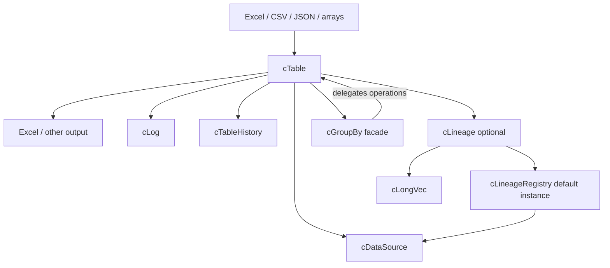
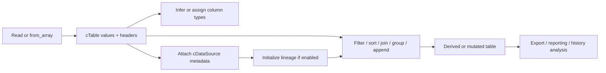

# cTable Architecture

> This document describes the design of the exported VBA modules in this repository. The implementation in `src/` is authoritative when it differs from this description. Examples are illustrative unless explicitly identified as executed tests.
>
> **Audience:** Library maintainers, contributors, and AI coding agents. For user-facing syntax, see the README and API reference; for detailed provenance behavior, see [LINEAGE.md](LINEAGE.md).

## 1. Purpose and boundaries

cTable is a pandas-inspired, in-process tabular data library implemented in Excel VBA. Its central abstraction is a `cTable`: a rectangular set of records and named columns that can be imported, filtered, transformed, joined, aggregated, and exported. Companion classes provide source metadata, optional cell provenance, grouped operations, change-history analysis, and diagnostics.

This is a **VBA object library**, not a database server or pandas runtime. Many operations materialize VBA arrays in memory, and Excel/Office APIs are used for supported I/O paths. The public surface uses **1-based** row and column positions.

## 2. Components and responsibilities

| Module | Role | Relationship to `cTable` |
| --- | --- | --- |
| `cTable.cls` | Primary data container, operations, import/export, type metadata, named indexes, API entry points | Central owner/coordinator |
| `cDataSource.cls` | Describes origins such as workbook/sheet, CSV, JSON, manual, or calculated sources | Attached source metadata; also registered for provenance |
| `cLineage.cls` | Optional per-table source attribution for cells, rows, and columns | Owned by a `cTable` when lineage is enabled |
| `cLineageRegistry.cls` | Project-wide interned source IDs and column-source maps | Shared **predeclared** instance used by lineage-aware tables |
| `cLongVec.cls` | Compact long-integer vector helper | Used by lineage internals |
| `cGroupBy.cls` | Lightweight grouping/column-selection facade | Holds a reference to a `cTable`, delegates calculations back to it |
| `cTableHistory.cls` | Snapshot timeline and entity change-event analysis | Owned by `cTable`; no permanent back-reference to the owner |
| `cLog.cls` | Status and error message collection | Used by `cTable` for diagnostics |
| `JsonConverter.bas` | JSON parsing/serialization support | Used by JSON I/O; third-party attribution must be preserved |

### Conceptual relationship diagram



The arrows denote conceptual use/ownership, not always direct class references. In particular, `cTableHistory` deliberately avoids holding a permanent reference to its parent.

## 3. The central `cTable` object

The bundled implementation stores:

- `m_Data()` — `Variant` matrix addressed as `(1..rowCount, 1..ColumnCount)`.
- `m_Headers()` — column names.
- `m_ColTypes()` — column `ctDataType` metadata, lazily allocated; an unallocated type array means `ctVariant` behavior.
- `m_Indexes` — dictionary of named lookup indexes; structural mutations invalidate these caches.
- `m_DataSource` — compatibility-oriented source metadata.
- `m_Lin`, `m_History`, `m_Log` — optional/owned supporting objects.
- `m_Version` — mutation version used to detect stale dependent state.

### Core invariants

1. Row and column counts agree with matrix/header/type dimensions.
2. Column names are the external identifiers for name-based operations; APIs also expose numeric column positions.
3. `Null` is the primary missing-value marker, interpreted in the context of column type.
4. A method returning a **new** `cTable` should leave its source unchanged; in-place routines explicitly mutate the receiver.
5. Structural and relevant value mutations must invalidate dependent indexes and stale grouped/history state.
6. When enabled, lineage must follow row/column reordering and data transformations—or degrade to `Unknown` rather than incorrectly claim an origin.

The storage model is designed for convenience and broad VBA compatibility, but operations such as `Append` allocate a new combined matrix and copy rows; repeated large appends should be profiled rather than assumed to be linear-time overall.

## 4. Data lifecycle and operation flow



### Import

Entry points in the bundled source include `read_excel_sheet`, `read_excel_table`, `read_excel_range`, `read_excel_ws`, `read_access_table`, `read_csv`, `read_json`, `read_text`, and `from_array`. Their signatures and behavior differ; do not treat all sources as having identical header/type inference semantics.

The `read_excel_sheet` API accepts a workbook path, optional sheet name, header flag, and other import options. The Excel readers use Excel objects, so compatibility depends on the host and its platform capabilities. Some input methods support bounded reads through `nrows`.

### Transform

Public operations include filters (`Where`, `WhereIn` and their negative variants), sorts (`SortBy`, `sort_values`), joins (`MakeJoin` and related interfaces), selection/projection, data type conversion, grouping, and append/combination. Verify the *specific* operation's return type before assigning with `Set`: some mutate in place, some return new tables, and some return arrays or scalar results.

### Export

`to_excel_range` writes to a supplied Excel `Range`, with optional headers and type-aware formatting. Other export paths are available in the source; consult their actual signatures rather than assuming a pandas-style `to_excel` method.

## 5. Types, missing values, and comparisons

`ctDataType` provides `ctVariant`, `ctString`, `ctLong`, `ctDouble`, `ctCurrency`, `ctDate`, and `ctBoolean`. `ctConvertErrors` provides preserve/coerce/raise choices for conversion paths. Readers can infer types; code may also inspect and set `dtype` metadata and perform conversions such as `astype`, `to_numeric`, or `to_datetime`.

The implementation uses VBA `Null` as a general missing value, including in typed columns. This is a cTable design convention, **not** VBA's native type system representing pandas `NaN` or `NaT`. Filters have configurable null behavior in the supplied October 2026 baseline. String matching is generally case-insensitive, with individual operations determining exact comparison semantics.

**Maintainer rule:** Any operation that builds a derived table must preserve or intentionally recompute headers, column types, and missing-value semantics. Test values and dtype metadata separately.

## 6. Indexes, versioning, and dependent handles

`cTable` maintains named lookup indexes and a version counter. Its common invalidation path (`p_ClearIndexes`) clears index state and advances the version; it is also part of the contract used by dependent objects.

`cGroupBy` is **not** a materialized table of groups. It stores the parent table, grouping keys, selected value column, and the parent's version at construction. The calculation lives in `cTable`. A group handle becomes stale after a relevant mutation and raises rather than silently using outdated row positions. Recreate the handle after modifying the table.

`cTableHistory` similarly records its source version. It builds time-ordered snapshot indexing lazily and caches entity-context change events. When the parent mutates, history is marked stale; reinitialize it before another query. It does not retain the parent `cTable` permanently, avoiding a circular reference.

### Historical snapshot example

```vb
Dim changes As cTable

t.history.Init "RunDate"
Set changes = t.HistoryFor("AccountID")
```

This is a *pattern*, not a promise that every financial-snapshot set is eligible: the history component expects a meaningful timestamp column and unique nonmissing entity keys per snapshot. For repeated rows per AccountID/date, use a more appropriate entity key or pre-aggregate before querying history.

## 7. Lineage and data-source architecture

When `EnableLineage` is on **before** a read, `cTable` can attribute imported values to a `cDataSource`. The per-table `cLineage` engine stores compact integer references, not a separate metadata object for each cell.

`cLineageRegistry` interns:

- Each distinct `cDataSource` into a **source ID**.
- Each source-ID-per-column vector into a **map ID**.

`cLineage` resolves attribution through uniform row mappings and more specific column/cell overlays. The representation accommodates a whole table from one workbook, a column from a calculation, and a combined table with different workbook sources in different rows.

Lineage may be disabled for lower overhead. Enabling it after data is already loaded cannot reconstruct origins that were never recorded. `cTable.DataSource` is a backward-compatibility accessor: for mixed-source lineage it may return `Nothing`, so use `LineageOfName`, `LineageExplain`, `LineageSources`, or the corresponding reporting APIs to inspect multi-source results.

**Critical integration detail:** `cLineageRegistry.cls` is exported with `VB_PredeclaredId = True`. Preserve that attribute when importing. Use the shared `cLineageRegistry` default instance, not `New cLineageRegistry`, which would create an incompatible private ID space. Do not call `ResetRegistries` while live lineage-enabled tables rely on those IDs.

See [LINEAGE.md](LINEAGE.md) for user examples and source tracking behavior.

## 8. Combining financial snapshots: illustrative flow

This flow matches the common use case of reading multiple identically structured `AccountSnapshots` sheets into one table.

```vb
Dim combined As cTable
Dim incoming As cTable
Dim i As Long

For i = LBound(FileList) To UBound(FileList)
    Set incoming = New cTable
    incoming.EnableLineage = True
    incoming.read_excel_sheet CStr(FileList(i)), "AccountSnapshots"

    If combined Is Nothing Then
        Set combined = incoming
    Else
        combined.Append incoming, strict:=True
    End If
Next i

If Not combined Is Nothing Then
    Call combined.sort_values( _
        by:=Array("RunDate", "AccountID"), _
        ascending:=Array(False, True), _
        inplace:=True)
End If
```

`Append` places incoming records after existing records and maps columns by name. With `strict:=True`, incoming column names must exist in the destination; it is **not** a bidirectional proof of schema identity. Append is equivalent to **UNION ALL**: it does not deduplicate rows. The snippet assumes a populated `FileList` and successful reads; production callers should handle empty arrays, workbook errors, and schema validation.

For bulk combination, the library also offers `append_many` and `from_tables`. Those accept collections or arrays of `cTable` objects, with options for strict handling and skipping empty tables. `from_tables` clones the first eligible input and appends the remainder.

## 9. External dependencies and host constraints

- The bundled `cTable` implementation explicitly requires a project reference to **Microsoft Scripting Runtime** for some typed declarations; changing all creation sites to `CreateObject` is not sufficient if early-bound types remain in signatures.
- Excel-specific object types (`Workbook`, `Worksheet`, `Range`, calculation state) make relevant paths dependent on Excel VBA and platform support.
- `JsonConverter.bas` is third-party code. Keep its original copyright/license notices and review its host-specific calls before claiming portability.
- The exported VBA class attributes are part of the source artifact. Importing `.cls`/`.bas` files is safer than pasting class text into new modules when hidden attributes matter.

No general claim of Windows/macOS parity is made here; compatibility should be established through actual regression runs on target hosts.

## 10. Design trade-offs

| Decision | Benefit | Cost / risk |
| --- | --- | --- |
| 2-D `Variant` matrix | Flexible in-memory table operations | Copies and memory growth for large datasets |
| Lazily allocated type array | Compatibility with untyped callers | Every transform must propagate type metadata carefully |
| Optional lineage | Provenance when needed, avoids overhead when not | Must be enabled before import for accurate origin capture |
| Registry-interned source/maps | Compact repeated provenance data | Shared-ID lifecycle must be respected |
| Version-checked grouping/history | Fails safely rather than using stale row mappings | Must recreate/reinitialize after mutations |
| Excel-oriented readers/writers | Familiar integration with workbook workflows | Excel host/platform dependencies |

## 11. Rules for contributors and AI coding agents

1. **Verify the API in source** before adding examples or calling a method. The library resembles pandas but intentionally differs in places.
2. **Keep public compatibility by default:** do not silently rename methods, reorder positional arguments, or change return types.
3. **Preserve paired metadata:** update `m_Data`, headers, dtypes, indexes/version, and lineage together whenever structural operations change row/column mapping.
4. **Handle failed attribution conservatively:** return `Unknown` when provenance cannot be established, not a fabricated source.
5. **Preserve exported attributes**, especially the registry's predeclared-instance attribute.
6. **Do not introduce stale caches:** ensure mutations invalidate indexes, grouped handles, and history where applicable.
7. **Test both lineage modes**, mixed-source appends, filters, joins, sorts, typed Nulls, and empty-table edge cases.
8. **Keep source files and docs synchronized:** update `CHANGELOG.md`, API reference, regression tests, and this architecture document when behavior or design contracts change.
9. **Respect third-party notices** in `JsonConverter.bas` and any future bundled dependencies.
10. **Distinguish static review from execution:** do not claim the VBA compiled or ran unless it was tested in an Excel VBA host.

## 12. Suggested regression matrix

| Area | Baseline checks |
| --- | --- |
| Import | Headers, inferred dtype, empty files/sheets, `nrows`, source metadata |
| Filtering | Name/index columns, inclusion/exclusion, Null behavior, type preservation |
| Sorting | Multiple keys/directions, stable row-to-lineage correspondence |
| Append | Multiple workbooks, unmatched headers, empty tables, duplicate retention |
| Joins | Key cardinalities, missing matches, right/left lineage attribution |
| Grouping | Grouped difference and cumulative operations; stale-handle rejection |
| History | Timeline, entity appearance/disappearance, duplicate-key rejection, re-init after mutation |
| Lineage | Disabled/enabled import, mixed sources, cell edits, registry stability |
| Export | Headers, values, types/number formats, host-specific exceptions |

## 13. Documentation ownership and evolution

This file explains architecture, not an exhaustive method catalog or a dated change history. Maintain separate documents for:

- `README.md` — audience, features, short usage example.
- `INSTALLATION.md` — importing VBA classes and enabling dependencies.
- `API-REFERENCE.md` — exact current public signatures and examples.
- `LINEAGE.md` — detailed provenance semantics and procedures.
- `CHANGELOG.md` — externally meaningful changes by release.
- `TESTING.md` — reproducible regression commands and expected outcomes.

When this file conflicts with a newer checked-in `.cls`/`.bas` export, **the current source code is authoritative**. Update the architecture description and note changed assumptions in the same pull request.
